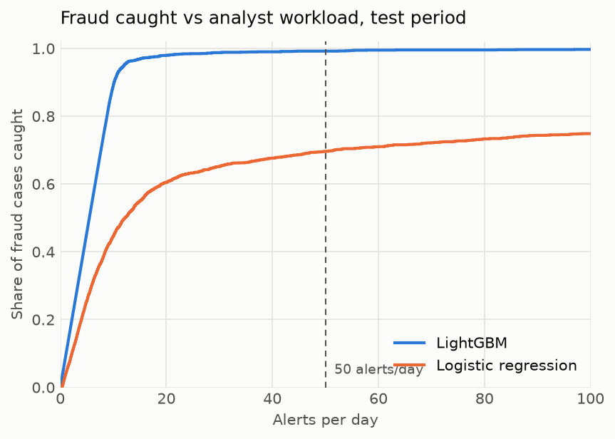
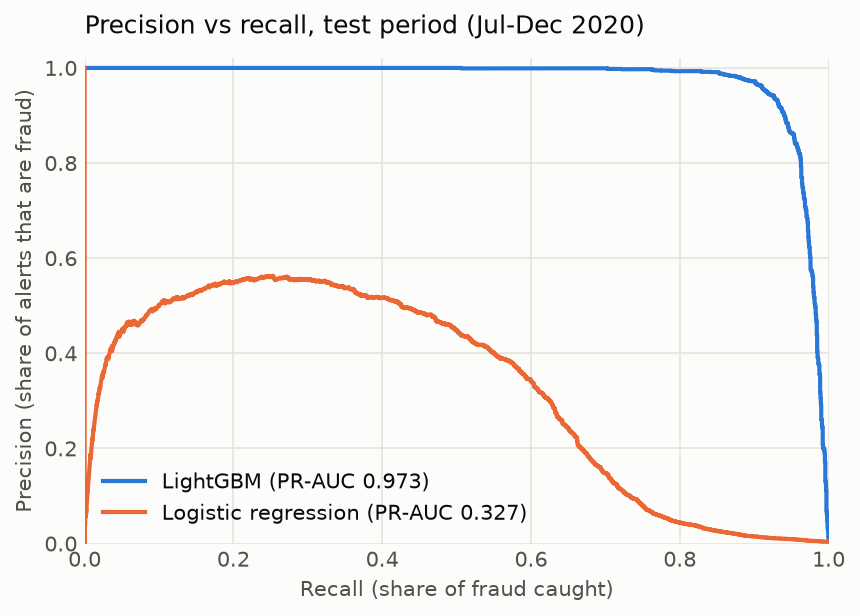
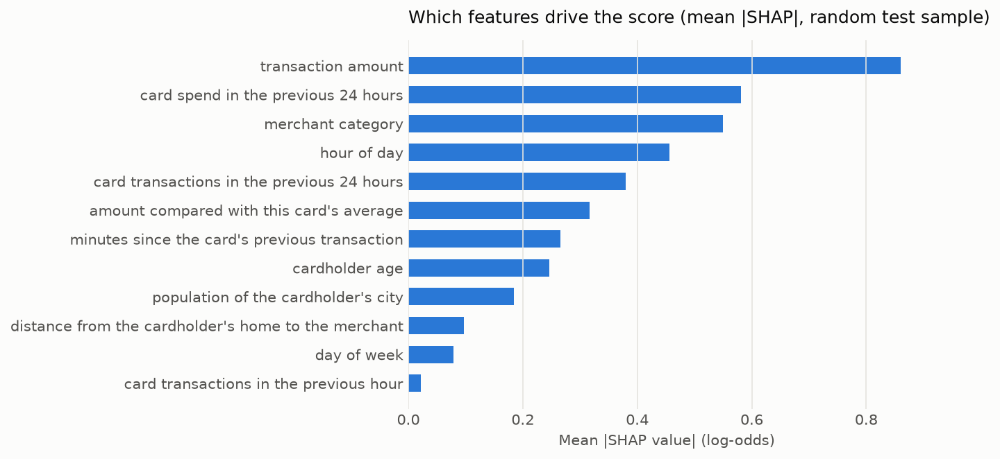

# fraud-alert-explainer

**If a fraud team can review N alerts a day, how much fraud does a model catch, and can a small local LLM explain each alert without making anything up?**

This repo answers both on public data. A LightGBM model scores card transactions. SHAP picks the reasons behind each alert. A local LLM (Ollama) turns those reasons into a short note for the analyst, and a deterministic check verifies that the note cites only the reasons SHAP gave it.

> **Data:** the [Sparkov simulated card-transaction dataset](https://www.kaggle.com/datasets/kartik2112/fraud-detection) (Kaggle, CC0): 1.85M transactions from 999 simulated cards, Jan 2019 to Dec 2020, 0.52% fraud. It contains no real customer or bank data. The setup mirrors work I've done professionally, but every number here comes from this public dataset and the code in this repo.

## Results

Split by time: train Jan 2019 to Mar 2020, validation Apr to Jun 2020, test Jul to Dec 2020 (525,661 transactions, 2,012 fraud, about 11 a day). Both models get the same features. The headline metric is PR-AUC (average precision), because with 0.4% fraud even a weak model scores a high ROC-AUC.

| Model | Test PR-AUC | Test ROC-AUC |
|---|---:|---:|
| LightGBM | **0.973** | 0.999 |
| Logistic regression (baseline) | 0.327 | 0.934 |



**Alerts per day vs fraud caught.** Each threshold is chosen on the *validation* period to fit a daily alert budget, then applied unchanged to the test period. That is why test volumes don't hit the budget exactly.

| Model | Budget (alerts/day) | Alerts/day on test | Precision | Fraud caught | Fraud $ caught |
|---|---:|---:|---:|---:|---:|
| LightGBM | 10 | 7.0 | 100% | 64% | 74% |
| LightGBM | 25 | 22.5 | 48% | 98% | 99% |
| LightGBM | 50 | 49.6 | 22% | 99% | 100% |
| LightGBM | 100 | 104.5 | 10% | 100% | 100% |
| Logistic regression | 10 | 9.6 | 50% | 44% | 60% |
| Logistic regression | 25 | 25.3 | 27% | 63% | 80% |
| Logistic regression | 50 | 51.2 | 15% | 70% | 85% |
| Logistic regression | 100 | 105.2 | 8% | 75% | 88% |

At about 25 alerts a day, roughly twice the daily fraud count, LightGBM catches 98% of fraud cases and half its alerts are real fraud. The baseline needs more than 100 alerts a day and still misses a quarter of them.

**Read this with care: the data is simulated, and the simulator makes fraud easy.** In the test period, 84% of fraud happens between 22:00 and 04:00 (vs 23% of legitimate transactions), and the median fraud amount is $371 (vs $47). Real card fraud is far noisier, so expect much lower PR-AUC in production. What carries over is the method: time split, past-only features, thresholds set on one period and checked on the next, and a budget framing instead of a single metric.

<details>
<summary>Precision-recall curves and global SHAP importance</summary>




</details>

## Alert explanations

For each alert, SHAP (TreeSHAP on the LightGBM model) ranks the features that pushed the score up. The top four become fact lines. A local model gets those facts with instructions to use only them, write no other numbers, and leave the fraud call to the analyst:

```
Model fraud probability: 99.9%
Reasons the model flagged this transaction, strongest first:
- transaction amount: $326.36
- merchant category: in-store grocery
- amount compared with this card's average: 5.2x
- hour of day: 01:00 (1 AM)
```

> *This transaction was flagged due to the unusually large amount of $326.36, which is 5.2 times the cardholder's average transaction amount. Additionally, the transaction occurred at 1 AM, which is an unusual hour for a grocery purchase.* (llama3.2:3b)

**The grounding check** ([`grounding.py`](src/fraud_alert_explainer/grounding.py)) uses no LLM judge. Each feature has a set of phrases ("previous 24 hours", "km", "Sunday", "late at night"…). An explanation counts as **grounded** if it:

- mentions at least one feature SHAP ranked,
- mentions no feature SHAP *didn't* rank, and nothing the model doesn't have (device, country, IP…),
- writes no number that isn't in the facts (rounding allowed).

Results: 40 alerts sampled from the test period at the 50/day threshold (15% of them labelled fraud), temperature 0, on a GTX 1650 (4 GB):

| Model | Alerts | Grounded | Cites a feature SHAP didn't rank | Invented numbers | SHAP reasons used | Latency p50 |
|---|---:|---:|---:|---:|---:|---:|
| `qwen2.5:1.5b` | 40 | 65% | 20% | 12% | 84% | 1.3s |
| `llama3.2:3b` | 40 | 80% | 20% | 0% | 84% | 2.6s |

Every explanation is in [`results/explanations/`](results/explanations). I read all 22 that failed the check: **17 were real errors and 5 were checker mistakes.** Of those 5, two are phrases my patterns misread ("a significant amount" that meant the 24-hour spend, and "potential travel" read as the travel category). One is a 0.3x ratio correctly rewritten as "30%". One explanation used wording the patterns didn't recognise at all. The last described the 24-hour spend as a "high value … spent".

### What goes wrong

- **Invented comparisons.** The most common error. "The amount is significantly higher than the card's average" when no average was given, or the 24-hour total relabelled as "the average daily spend". The check catches these because "average" maps to a feature SHAP didn't rank.
- **Invented arithmetic (qwen).** Given "9.2x the card's average" and $567.30, it writes "the card's average of $61.80" (the true value is about $61.66). Caught by the number check.
- **Wrong direction, not caught.** SHAP reasons can be *low* values: on this data a purchase far below the card's average can raise the score. Both models still describe most reasons as "high" or "large" (37 of 40 explanations for qwen, 33 for llama). After I added "a reason can be an unusually low value as well as a high one" to the prompt, llama3.2 improved from 70% to 80% grounded, but qwen2.5 fell from 85% to 65% because it started computing averages from the ratio. The check verifies *which* features are cited, not whether "high" or "low" is right.
- **Plausible but unsupported context, not caught.** "Gas and transport, a category that typically involves high-value transactions" mentions only a ranked feature, so it passes, but the claim about the category comes from the LLM, not the model.

40 alerts and one run per model is a small sample. The gaps between the two models are directional, not significant.

## How it works

```
data.py      raw Kaggle CSVs → one time-ordered frame (names, street, job, merchant name dropped)
features.py  amount, merchant category, hour, day, age, home-to-merchant distance, city size,
             and card history: transactions in the last 1h/24h, spend in the last 24h, minutes since
             the previous transaction, amount vs the card's average so far (all past-only)
model.py     time split, LightGBM (early-stopped on validation PR-AUC), logistic baseline, metrics
alerts.py    threshold → alerts/day, precision, fraud caught, fraud $ caught
explain.py   TreeSHAP top reasons → fact lines → prompt
llm.py       Ollama /api/chat client (temperature 0)
grounding.py deterministic citation and number check, summary table
pipeline.py  `train` and `explain` runs that write results/ and docs/img/
```

Card-history features use only earlier transactions on the same card. A test rebuilds the features on a truncated dataset and checks they match, so nothing leaks from the future. Gender is in the raw data but deliberately not a feature.

## Run it

Requires [uv](https://docs.astral.sh/uv/) and, for the explanations, [Ollama](https://ollama.com).

```bash
make install
```

Download the dataset from [Kaggle](https://www.kaggle.com/datasets/kartik2112/fraud-detection) (202 MB zip) and put `fraudTrain.csv` and `fraudTest.csv` in `data/raw/`. Or use Kaggle's own client:

```bash
uv run --no-project --with kagglehub python -c "import kagglehub; print(kagglehub.dataset_download('kartik2112/fraud-detection'))"
```

Then:

```bash
make train      # features, both models, results/metrics.json, results/operating_points.md, charts (~5 min)
ollama pull qwen2.5:1.5b
ollama pull llama3.2:3b
make explain    # explains 40 test alerts per model, writes results/explanations/ (~4 min)
make check      # ruff, mypy --strict, pytest with coverage (no data or Ollama needed)
```

Without `make`, run the `uv run ...` line from the [Makefile](Makefile).

## What I'd do differently

- **Use harder data.** Sparkov's fraud is separable by hour and amount alone. I'd repeat this on IEEE-CIS or a dataset with chargeback delays, where labels arrive weeks late and the split has to account for that.
- **Use a stronger baseline.** The logistic regression gets raw hour and amount, so it can't see that both ends of the day are risky. Cyclic hour and log amount would make it a fairer reference, and the gap would shrink.
- **Check direction, not just citation.** Pass each reason's direction to the LLM ("lower than usual") and check that the explanation's wording agrees with the SHAP sign.
- **Template first, LLM second.** For a regulated alert queue, I'd render the facts with a fixed template and let the LLM only rephrase it, rejecting any rephrasing that fails the check.
- **Calibrate and monitor.** Calibrate scores and track alert volume and precision per week. A threshold set in June drifts by December (the 10/day budget produced 7 a day on test).
- **Review the features for fairness.** Age is a strong feature here. In production, I'd review whether it belongs in the model.

## License

MIT for the code. The dataset is CC0 and is not redistributed here.
